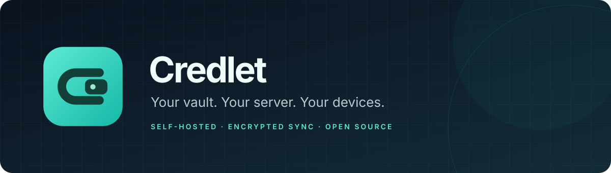
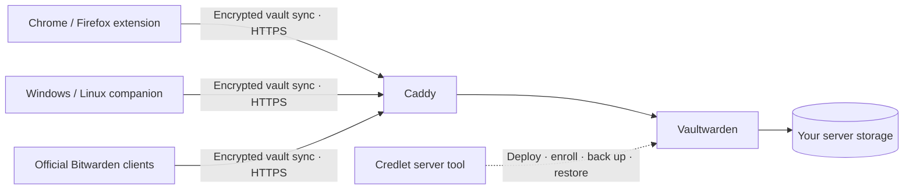

<p align="center">
  
</p>

<p align="center">
  <a href="https://github.com/hamb1y/credlet/actions/workflows/release.yml"></a>
  <a href="https://github.com/hamb1y/credlet/releases/latest"></a>
  <a href="LICENSE"></a>
  
</p>

<p align="center">
  <b>A personal password vault, hosted on your own server.</b><br>
  Encrypted sync, website passkeys, authenticator codes and native application filling.
</p>

<p align="center">
  <a href="https://github.com/hamb1y/credlet/releases/latest">Download</a> ·
  <a href="docs/self-hosting.md">Self-host</a> ·
  <a href="desktop/README.md">Desktop app</a> ·
  <a href="extension/README.md">Browser extension</a> ·
  <a href="docs/testing.md">Testing</a>
</p>

Previously **Lockbox**. Existing vaults and native app links keep working; see
[upgrading to Credlet](docs/upgrading.md).

## One vault, across your devices

Credlet brings together a single-owner Vaultwarden deployment, Chrome and
Firefox extensions, and a Windows/Linux desktop companion. Your clients encrypt
vault records before syncing them to your server. Official Bitwarden clients
can connect to the same vault, including the Android app for system autofill
and passkeys.

- **Passwords and codes together.** Create, edit, search and trash encrypted
  logins. Generate passwords and display or fill six-digit TOTP codes.
- **Passkeys in your browser.** Create and use synced ES256 passkeys through an
  explicit approval screen with a fresh master-password check.
- **Fill native apps.** Capture an application field, review its executable,
  explicitly link a login and fill its username, password or code.
- **A server you control.** Digest-pinned Vaultwarden and Caddy containers,
  automatic HTTPS, local-only enrollment and registration closed after setup.
- **Recovery you can rehearse.** Consistent backups include the database,
  attachments and server keys; restoration validates the archive and owner.

## Downloads

Get the files and `SHA256SUMS` from the [latest release](https://github.com/hamb1y/credlet/releases/latest).
Native downloads target **x64**. Keep each extracted directory together.

| Component | Windows | Linux | What you need |
| --- | --- | --- | --- |
| Desktop companion | `credlet-desktop-VERSION-win-x64.zip` | `credlet-desktop-VERSION-linux-x64.tar.gz` | A desktop session; Linux accessibility bus and glibc 2.35+ |
| Server management tool | `credlet-server-VERSION-win-x64.zip` | `credlet-server-VERSION-linux-x64.tar.gz` | Docker + Compose v2; Windows uses Docker Desktop's Linux engine |
| Chrome extension | `credlet-chrome-VERSION.zip` | Same ZIP | Extract, then **Load unpacked** in Developer mode |
| Firefox extension | `credlet-firefox-VERSION-unsigned.xpi` | Same XPI | Temporary development installation; stable Firefox requires Mozilla signing |

Python and Node are bundled in native downloads. The server management tool
starts the vault and HTTPS proxy in Docker; it also handles enrollment, backup
and recovery. Matching extension reviewer sources and build metadata accompany
each release. [Verify downloads and make a release →](docs/releases.md)

**Current distribution:** desktop binaries are unsigned. Chrome Web Store
publication is not configured. Firefox signing is optional in CI when Mozilla
credentials are supplied; unsigned packages are labeled explicitly. macOS
releases are deferred.

## Start your server

Point a DNS name at your server and allow TCP 80/443 and UDP 443. Install Docker
and Compose v2, then run the extracted Linux server tool:

```sh
./credlet-server init --hostname vault.your-domain.com --email you@your-domain.com
./credlet-server enroll
```

Create the configured owner account at **http://localhost:8222**. For a remote
server, use an [SSH tunnel](docs/self-hosting.md#install-from-source) to reach
that local-only page. Then close enrollment and start HTTPS:

```sh
./credlet-server up
./credlet-server check
```

On Windows, use `.\credlet-server.exe` with the same arguments. In each client,
select **Self-hosted**, enter `https://vault.your-domain.com`, and sign in with
that owner account. [Full setup, storage and recovery guide →](docs/self-hosting.md)

## How it fits together



The extension checks the exact website origin before filling. Native app
filling uses accessibility APIs and a reviewed executable identity. Vault
secrets remain in memory while unlocked; Credlet clients lock after five
minutes and on process termination. Browser passkeys are handled by the
extension; the desktop companion fills native text fields.

## Scope and security

Credlet is an early release for a **single owner**. Browser passkeys currently
support explicit ES256 ceremonies; advanced WebAuthn features, offline unlock
and automatic save prompts are outside the current client feature set.
Applications must expose compatible writable accessibility fields for native
filling. [Client behavior and limits →](extension/README.md)

The server cannot recover your master password. Keep your vault-login recovery
code outside the vault. Backup archives contain sensitive account metadata and
server keys and are **not archive-encrypted**; keep encrypted off-host copies.
No independent security audit is claimed. [Report a vulnerability →](SECURITY.md)

## Build and contribute

Use Node **24.22.1** and Python **3.11.4+** for source checks. Native release
builds use pinned PyInstaller dependencies and their target OS.

```sh
git clone https://github.com/hamb1y/credlet.git
cd credlet
npm ci
npm test
npm run build
python3 -m unittest discover -s tests -v
python3 tools/package-extension.py
```

See [contributing](CONTRIBUTING.md), [release automation](docs/releases.md),
[test coverage](docs/testing.md), [desktop builds](desktop/README.md), and
[client setup](docs/clients.md).

## License and acknowledgements

Credlet's first-party code is [MIT licensed](LICENSE). It builds on
[Vaultwarden](https://github.com/dani-garcia/vaultwarden),
[Caddy](https://github.com/caddyserver/caddy), and the Bitwarden client protocol.
Upstream software retains its own licenses; see [third-party notices](THIRD_PARTY_NOTICES.md).
Credlet is an independent project and is not affiliated with Bitwarden.
